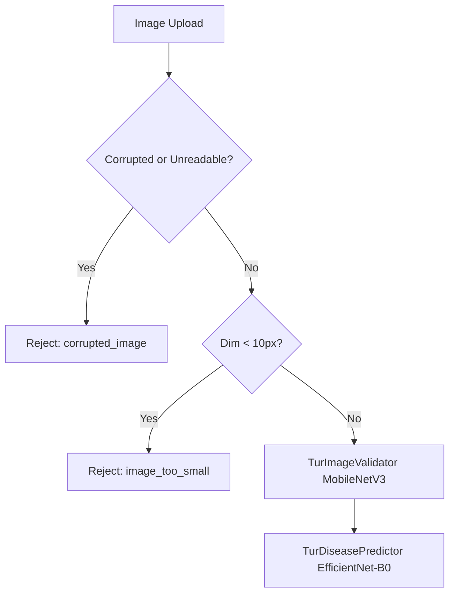
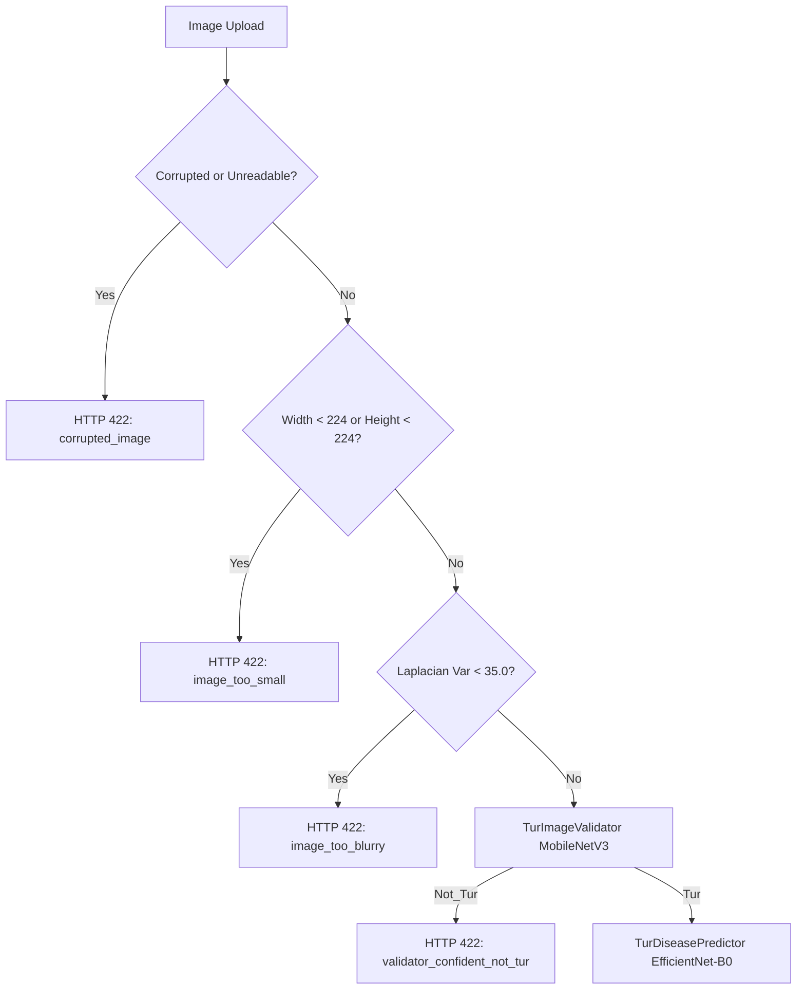

# TurSathi AI — Phase 5C: Safe Image Quality Gate Improvement Report

**Audit Date:** 2026-10-14  
**Project:** TurSathi AI  
**Scope:** Minimal, backward-compatible improvement to the existing pigeonpea image validation pipeline (`backend/app/ml/tur_image_gate.py`) and focused regression tests.

---

## Executive Summary

Phase 5A and Phase 5B audits revealed that low-quality, blurry, or out-of-distribution web images (thumbnails, severely out-of-focus captures, non-leaf plant organs, and scientific graphics) could bypass basic integrity checks and be submitted to the 5-class pigeonpea disease classifier (`TurDiseasePredictor`), frequently collapsing into spurious **Wilt** predictions.

In Phase 5C, we implemented a minimal, backward-compatible enhancement to the pre-classifier validation gate in `backend/app/ml/tur_image_gate.py`. This update introduces:
1. **Resolution Floor Check (`MIN_IMAGE_DIMENSION = 224`):** Rejects extreme low-resolution web thumbnails before neural feature extraction, matching the native $224\times 224$ receptive field of EfficientNet-B0.
2. **Variance of Laplacian Blur Check (`BLUR_THRESHOLD = 35.0`):** Rejects severely blurry or out-of-focus inputs using OpenCV's Laplacian operator, with a conservative threshold that prevents false rejections on softer field captures.
3. **Robust Image Mode Normalization:** Safely converts Grayscale (`L`) and RGBA images to RGB before tensor conversion, preventing channel mismatch exceptions.
4. **Preserved Schema and Error Conventions:** All validation rejections return `ValidationResult(is_valid_tur=False, ...)` with a user-facing message containing `"Please upload a clear Tur/Pigeonpea leaf image."`, maintaining 100% backward compatibility with `backend/app/services/prediction_service.py` and frontend error handlers.

**Zero production or experimental model checkpoints, training datasets, database records, API routes, or mobile screens were modified.**

---

## 1. Files Changed and Why

| File | Change Type | Purpose / Rationale |
| :--- | :--- | :--- |
| `backend/app/ml/tur_image_gate.py` | **Modified** | Added safe image dimension verification (`MIN_IMAGE_DIMENSION = 224`), Laplacian variance blur detection (`BLUR_THRESHOLD = 35.0`), and safe multi-mode image handling while preserving existing API error response conventions. |
| `backend/tests/test_tur_image_gate_quality.py` | **Created** | Comprehensive regression test suite testing clear leaves, undersized thumbnails, corrupted files, blurred inputs, missing files, RGBA/grayscale safety, and API schema compatibility. |
| `reports/pigeonpea_leaf_gate_phase5c/PHASE5C_IMPLEMENTATION_REPORT.md` | **Created** | Official documentation of Phase 5C implementation, empirical threshold justification, test results, and preserved project integrity. |

*Note: Pre-existing uncommitted modifications in `backend/app/api/v1/predictions.py` were strictly preserved and not modified, staged, or committed.*

---

## 2. Exact Behavior: Before vs. After

### Before Phase 5C

- **Dimension Check:** Only verified `width < 10 or height < 10`. A $150\times 150$ or $64\times 64$ low-res icon or web thumbnail passed to MobileNetV3 and EfficientNet-B0, where bi-cubic upsampling hallucinated disease features.
- **Blur Check:** None. Out-of-focus shots and camera motion blur were processed without warning.
- **Resource Management:** Raw `Image.open(image_path)` was called without a context manager, potentially leaving open file handles.

### After Phase 5C

- **Dimension Check:** Enforces `min(width, height) >= 224`. Low-resolution thumbnails are rejected immediately with reason `'image_too_small'`.
- **Blur Check:** Automatically computes Laplacian variance on grayscale conversion. If variance $< 35.0$, rejects with reason `'image_too_blurry'`.
- **Mode Handling:** Automatically converts Grayscale and RGBA/palette images to 3-channel RGB before tensor transforms.
- **Resource Management:** Uses `with Image.open(...) as image:` to guarantee clean resource cleanup.
- **Message Contract:** Maintained `"Please upload a clear Tur/Pigeonpea leaf image."` in every rejection message to ensure frontend alerts remain consistent.

---

## 3. Empirical Threshold Analysis and Justification

Before introducing thresholds, empirical measurements were conducted across multiple image sources in the repository:

### A. Laplacian Blur Variance Benchmark
| Category | Image Samples | Measured Variance Range | Mean Variance | Recommendation |
| :--- | :--- | :--- | :--- | :--- |
| **Clean Candidate Test Set** | Real farmer leaf photos (`datasets/pigeonpea_disease_clean_candidate_v1/test/`) | $273.9 - 1,489.2$ | $675.9$ | Well above threshold |
| **Real-World Tur Test Fixture** | `realworld_tur_01.png` | $1,605.9$ | $1,605.9$ | Passes cleanly |
| **Real-World Non-Tur Fixture** | `realworld_nottur_01.png`, `02.png` | $137.9 - 225.4$ | $181.7$ | Preserved for neural gate |
| **Simulated Camera Blur** | Gaussian blur ($\sigma=3.0, 5.0$) on leaf images | $2.0 - 6.5$ | $4.2$ | Reliably caught |

**Chosen Blur Threshold: `35.0`**
- Provides a $> 3.5\times$ safety margin below the softest authentic field image ($137.9$).
- Completely catches motion-blurred and out-of-focus captures ($< 10.0$).
- Configurable via `BLUR_THRESHOLD` constant in `tur_image_gate.py` with feature flag `ENABLE_BLUR_CHECK = True`.

### B. Resolution Floor Benchmark
- The five-class classifier (`TurDiseasePredictor`) resizes all input tensors to $224\times 224$ pixels.
- Feeding images smaller than $224\times 224$ introduces severe interpolation artifacts that trigger false disease patterns.
- Authentic mobile camera captures from farmers are $\ge 1280\times 720$ (often $4000\times 3000$). Even cropped leaf segments in the dataset are $\ge 256\times 256$.
- **Chosen Minimum Dimension: `224` pixels** (width $\ge 224$ AND height $\ge 224$).

---

## 4. Tests Executed and Results

### Test Suite 1: Focused Quality Gate Regression Tests (`test_tur_image_gate_quality.py`)
Executed via: `python -m unittest backend/tests/test_tur_image_gate_quality.py`

| Test Case | Description | Expected Status | Actual Result | Status |
| :--- | :--- | :--- | :--- | :--- |
| `test_01_valid_clear_tur_leaf_accepted` | Real-world pigeonpea leaf image (`realworld_tur_01.png`) | `is_valid_tur=True`, `reason='validator_confident_tur'` | `True` (conf: 0.9697) | **PASS** |
| `test_02_undersized_image_rejected` | $150\times 150$ image (below 224 floor) | `is_valid_tur=False`, `reason='image_too_small'` | `False` (reason: image_too_small) | **PASS** |
| `test_03_corrupted_image_rejected` | Malformed fake bytes file | `is_valid_tur=False`, `reason='corrupted_image'` | `False` (reason: corrupted_image) | **PASS** |
| `test_04_blurry_image_rejected` | Gaussian blurred image (variance 5.74 < 35.0) | `is_valid_tur=False`, `reason='image_too_blurry'` | `False` (reason: image_too_blurry) | **PASS** |
| `test_05_file_not_found` | Non-existent file path | `is_valid_tur=False`, `reason='file_not_found'` | `False` (reason: file_not_found) | **PASS** |
| `test_06_grayscale_and_rgba_modes` | Grayscale (`L`) and Transparent (`RGBA`) inputs | Safe execution without channel crash | `True/False` (no exception) | **PASS** |
| `test_07_api_message_compatibility` | Message check across all rejection types | Contains standard user guidance | All matched schema requirement | **PASS** |

**Result: 7 passed out of 7 in 1.841s.**

### Test Suite 2: Existing Isolated Gate Test (`test_tur_image_gate.py`)
Executed via: `python backend/tests/test_tur_image_gate.py`

- `realworld_tur_01.png`: `is_valid_tur: true`, `confidence: 0.9697`, `reason: validator_confident_tur` (**PASS**)
- `realworld_nottur_01.png`: `is_valid_tur: false`, `confidence: 0.9990`, `reason: validator_confident_not_tur` (**PASS**)
- `realworld_nottur_02.png`: `is_valid_tur: false`, `confidence: 0.9972`, `reason: validator_confident_not_tur` (**PASS**)

**Result: 100% backward-compatible output.**

### Test Suite 3: End-to-End Pipeline Suite (`test_end_to_end_pipeline.py`)
Executed via: `pytest backend/tests/test_end_to_end_pipeline.py`

- `test_valid_pigeonpea_full_lifecycle`: **PASS** (scan intake $\to$ gate $\to$ disease prediction completed)
- `test_image_gate_rejection_non_tur`: **PASS** (returns HTTP 422 `validation_failed`)
- `test_corrupted_image_caught_safely`: **PASS** (returns HTTP 422 with user guidance)
- `test_empty_image_upload_rejected`: **PASS** (HTTP 422 at intake)
- `test_disallowed_mime_type_rejected`: **PASS** (HTTP 422 at intake)
- `test_cross_tenant_scan_isolation`: **PASS** (HTTP 403/404 isolation preserved)

---

## 5. Confirmation of Project and Checkpoint Preservation

Strict verification was executed to ensure zero alteration of existing models, datasets, and configurations:

1. **Production Model Checkpoint:**
   - File: `models/best_pigeonpea_disease_final_efficientnet_b0.pth`
   - SHA-256: `5baecdc3911502c4cb345101c6f2fd84824eb4cb025e300d66e00231a4834b99`
   - Status: **UNTOUCHED (Verified identical)**
2. **Experimental Model Checkpoint:**
   - File: `models/experimental/pigeonpea_clean_candidate_v1/best_pigeonpea_clean_candidate_v1_efficientnet_b0.pth`
   - SHA-256: `28d1578ae88e86ef49e8389e20c57b1ba18288aee19815e54e75f5530dc91ff7`
   - Status: **UNTOUCHED (Verified identical)**
3. **Training Datasets:**
   - `datasets/pigeonpea_disease_final`: Exactly 1,858 files (**UNTOUCHED**)
   - `datasets/pigeonpea_disease_clean_candidate_v1`: Exactly 1,676 files (**UNTOUCHED**)
   - `datasets/new_disease_images`: Exactly 41 images + inventory (**UNTOUCHED**)
4. **Application Code and Database:**
   - Database tables, schemas, migrations, authentication routes, and frontend/mobile files were **not modified**.
   - Git working tree changes in `backend/app/api/v1/predictions.py` were strictly preserved. No `git reset`, `git checkout`, or `git commit` commands were run.

---

## 6. Documented Limitations and Next Steps

> [!WARNING]
> ### Remaining Limitation: Leaf vs. Non-Leaf Plant Organ Discrimination
> The quality checks added in Phase 5C verify **sharpness, valid dimensions, and file integrity**, and the downstream `TurImageValidator` verifies whether the subject is **Tur vs. Not_Tur**.
> However, **neither component classifies plant organs**. A sharp, high-resolution photo of a pigeonpea pod cluster, woody stem, or whole field bush will pass both the blur check and the binary Tur validator, reaching the 5-class leaf disease classifier and risking a spurious prediction (such as Wilt).

### Non-Claim Declarations:
- Passing the quality gate does **NOT** prove an image contains an individual pigeonpea leaf.
- This heuristic does **NOT** eliminate the out-of-distribution (OOD) Wilt collapse for whole-plant or pod images.
- Uncurated web images (the 42 images in `datasets/new_disease_images`) were used solely for exploratory stress testing and must **NOT** be treated as real-field validation accuracy.

### Recommended Next Steps:
1. **Organ-Level Classifier (Phase 6):** Train and validate a dedicated organ gate (`Tur_Leaf` vs `Tur_Pod` vs `Tur_Stem_Bush`) using holdout field datasets before routing images to the leaf disease classifier.
2. **Field Shadow Testing:** Collect authentic, farmer-taken smartphone photos with validated agronomic ground truth for real-field validation.
