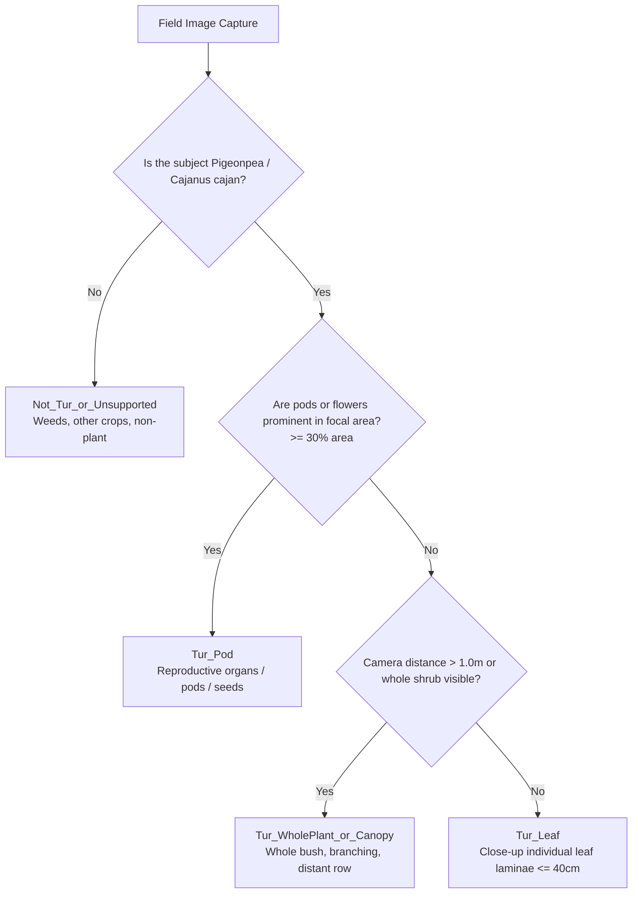
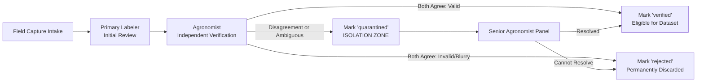
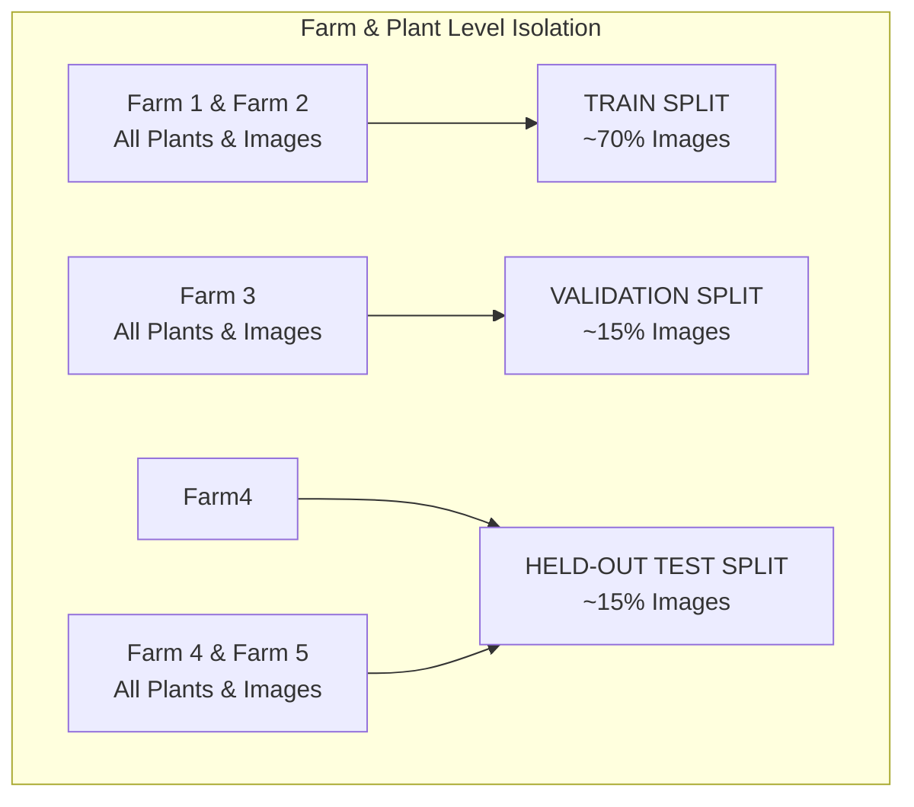

# TurSathi AI — Phase 5D-B: Field Dataset Collection Preparation Plan

**Document Version:** 1.0  
**Date:** 2026-10-14  
**Project:** TurSathi AI / AgriMind AI  
**Reference Design:** [`reports/pigeonpea_organ_validator_design/PHASE5D_A_DESIGN_REPORT.md`](file:///c:/Users/admin/OneDrive/Documents/Desktop/TurSathi%20AI/reports/pigeonpea_organ_validator_design/PHASE5D_A_DESIGN_REPORT.md)  
**Scope:** Field protocol, metadata schema, capture specifications, and leakage-proof pipeline preparation for authentic pigeonpea organ data collection (`Tur_Pod` and `Tur_WholePlant_or_Canopy`).

---

## Executive Summary

Phase 5D-A confirmed that the existing repository lacks verified training and evaluation data for pigeonpea reproductive organs (`Tur_Pod`: 0 verified images) and authentic whole-shrub canopies (`Tur_WholePlant_or_Canopy`: 0 healthy whole-plant field photos). Without these datasets, training an organ-level validator to eliminate the Out-of-Distribution (OOD) Wilt collapse is scientifically impossible.

This preparation plan establishes a rigorous, non-destructive field data collection workflow. It defines exact capture protocols, privacy safeguards, an auditable metadata CSV schema, dual-agronomist verification rules, a quarantine workflow for uncertain labels, and a plant/farm-level group partitioning strategy.

**Strict Preservation Notice:** This phase is operational preparation only. Zero existing code, model checkpoints, training datasets, database records, API contracts, frontend pages, or mobile screens have been modified.

---

## 1. Collection Categories & Bounded Definitions

To prevent annotation ambiguity during field operations, collectors and agronomists must classify images into strictly bounded, mutually exclusive categories:

### A. Category 1: `Tur_Pod`
* **Target Structures:** Pigeonpea seed pods, developing pod clusters, green pods, mottled/striated pods, mature drying pods, pod-borer damaged pods, and flowering racemes.
* **Visual Framing:** Pods must occupy $\ge 30\%$ of the image foreground or form the explicit focal point of the camera.
* **Context Foliage:** Minor background foliage is permissible provided pods remain the dominant subject.
* **Intended Pipeline Action:** Rejected by the future organ validator with HTTP 422:
  `"Pigeonpea pod detected. Pod disease and borer diagnosis will be introduced in Phase 6. Please capture a leaf for foliar disease diagnosis."`

### B. Category 2: `Tur_WholePlant_or_Canopy`
* **Target Structures:** Full pigeonpea shrub architecture, whole-canopy views, distant row shots, woody main stems, root crowns, and panoramic plant perspectives.
* **Visual Framing:** Captured from a distance $> 1.0\text{ meter}$, or framing the shrub from soil level to crown, where individual leaves occupy $< 15\%$ of the frame.
* **Health Representation:** Must capture both vigorous green canopies and naturally senescing / drying plants to prevent the model from learning that "whole plant = brown/wilted".
* **Intended Pipeline Action:** Rejected by the future organ validator with HTTP 422:
  `"Distant whole-plant shot detected. Please hold your camera 20-30 cm away from an individual leaf for disease diagnosis."`

---

## 2. Collection Volume Targets & Geographic Distribution

Following the statistical recommendations in Phase 5D-A, collection must span at least **five geographically separated farm plots** to capture diverse soil backgrounds, lighting conditions, cultivar morphologies, and crop spacing.

| Class Label | Minimum Verified Target | Target Farm Plots | Minimum Plants per Farm | Target Growth Stages |
| :--- | :---: | :---: | :---: | :--- |
| **`Tur_Pod`** | **250 verified images** | $\ge 5$ distinct farms | $\ge 10$ unique plants | Flowering/pod initiation, pod development (green), maturity (brown/dry), pest damage |
| **`Tur_WholePlant_or_Canopy`** | **200 verified images** | $\ge 5$ distinct farms | $\ge 10$ unique plants | Vegetative branching, peak flowering canopy, mature pod stage, post-harvest drying |
| **`Not_Tur_or_Unsupported`** | 100 field distractors | $\ge 5$ distinct farms | N/A | Intercropped crops (soybean, cotton), field weeds (parthenium), bare soil, farm tools |

### Geographic Plot Distribution Requirements
* Minimum of 5 distinct agricultural locations (e.g., Plot A: Jalna, Plot B: Parbhani, Plot C: Nanded, Plot D: Latur, Plot E: Akola, or equivalent representative pigeonpea belts).
* Plots must be separated by at least $5\text{ km}$ to prevent micro-climatic and soil-color correlation.
* Distinct regional cultivars (e.g., BDN-711, BSMR-736, PKV-Tara) should be documented per plot where available.

---

## 3. Metadata Schema & CSV Template Specification

All field captures must be cataloged in real time using the standardized CSV metadata template located at:
[`reports/pigeonpea_organ_dataset_collection/field_metadata_template.csv`](file:///c:/Users/admin/OneDrive/Documents/Desktop/TurSathi%20AI/reports/pigeonpea_organ_dataset_collection/field_metadata_template.csv)

### Field Descriptions and Constraints

| Column Name | Data Type | Mandatory? | Allowed Values / Format | Description |
| :--- | :--- | :---: | :--- | :--- |
| `filename` | String | **YES** | `[farm_id]_[class]_[seq].jpg` | Unique filename (e.g., `F01_POD_001.jpg`). No spaces. |
| `class_label` | String | **YES** | `Tur_Pod`, `Tur_WholePlant_or_Canopy`, `Tur_Leaf`, `Not_Tur_or_Unsupported` | Standardized organ classification category. |
| `plant_id` | String | **YES** | Format: `F{farm_id}_P{plant_seq}` | Unique identifier for the individual physical shrub. Essential for leakage prevention. |
| `farm_id` | String | **YES** | Format: `FARM_[REGION]_[NUM]` | Anonymized farm/plot identifier (e.g., `FARM_MAH_01`). |
| `capture_date` | Date | **YES** | `YYYY-MM-DD` | Date of field capture. |
| `verification_status` | String | **YES** | `verified`, `quarantined`, `rejected` | Dual-verification status. |
| `verifier_reference` | String | **YES** | `[Name/ID] ([Role])` | Name or professional credential of verifying agronomist. |
| `growth_stage` | String | Optional | `vegetative`, `flowering`, `pod_filling`, `maturity` | Phenological stage of the pigeonpea crop. |
| `camera_device` | String | Optional | e.g., `Redmi_Note_11`, `Galaxy_M32` | Smartphone or camera model used for capture. |
| `lighting_condition` | String | Optional | `bright_sun`, `overcast`, `morning_light`, `shadow` | Ambient environmental illumination. |
| `notes` | String | Optional | Text | Observational notes (e.g., cultivar name, pest presence). |

---

## 4. Field Photo-Capture Guidance & Quality Standards

To ensure images satisfy the Phase 5C quality gate (`resolution >= 224x224`, `Laplacian variance >= 35.0`) and provide clean diagnostic features:

### A. General Quality Protocols
1. **Resolution:** Minimum $1280 \times 720$ pixels native smartphone capture. Do not downscale or apply social media compression (e.g., avoid sharing via WhatsApp/Telegram before ingestion).
2. **Focus & Sharpness:** Tap on the camera screen to lock focus on the primary subject. Re-capture if motion blur or hand jitter occurs.
3. **Lighting & Shadows:** Capture during natural daylight (8:00 AM – 5:00 PM). Avoid severe backlight (lens flare) and harsh operator shadows falling across the subject.
4. **Orientation:** Maintain natural portrait or landscape orientation without tilted diagonal angles.

### B. Specific Capture Protocols by Category

#### 1. Protocol for `Tur_Pod`:
- **Distance:** Hold phone $15\text{ cm} - 35\text{ cm}$ from the target pod cluster.
- **Framing:** Pods should be centered and occupy $\ge 30\%$ of the frame.
- **Diversity:** Capture both individual pods and multi-pod clusters. Include healthy pods, borer-damaged pods, green immature pods, and brown dried pods.

#### 2. Protocol for `Tur_WholePlant_or_Canopy`:
- **Distance:** Stand $1.0\text{ m} - 2.5\text{ meters}$ from the shrub.
- **Framing:** Frame the entire plant from ground level to top foliage, or capture the full lateral canopy spread.
- **Diversity:** Include solitary shrubs, dense hedge-row plants, healthy vigorous bushes, and senescing / drying plants.

---

## 5. Labeling Protocol & Quarantine Workflow for Uncertain Cases

### Strict Quarantine Rules
1. **Zero Uncertain Labels in Training/Test:** Any image with ambiguous organ presentation (e.g., pods and leaves occupying equal visual area, blurred depth of field, or unidentifiable disease) must be marked `verification_status = "quarantined"`.
2. **Quarantine Directory Isolation:** Quarantined images must be stored in a dedicated `quarantine/` staging subfolder, completely segregated from training and holdout datasets.
3. **No Automated Relabeling:** It is strictly prohibited to re-label quarantined images using model predictions, clustering scripts, or file metadata heuristics. Every transition from `quarantined` to `verified` requires explicit sign-off by a certified agronomist.

---

## 6. Privacy, Ethics & Data Governance

1. **Farmer Privacy:**
   - Photographs must **never contain human faces, hands, clothing, children, or identifiable personal property**.
   - If an accidental hand or bystander enters the frame, the image must be deleted on site and re-captured.
2. **Location Anonymization:**
   - Raw GPS coordinates containing exact farm household locations must **not** be published in public manifests.
   - Farm identifiers must be abstracted to generalized codes (e.g., `FARM_MAH_01`, `FARM_MAH_02`) referencing general taluka/district levels.
3. **Farmer Consent:**
   - Field photography must be conducted with the explicit permission of the field owner or agricultural extension coordinator.

---

## 7. Leakage Prevention & Split Strategy

To prevent the cross-split contamination documented in historical project audits:

### Three-Tier Leakage Filter:
1. **Tier 1: Exact Duplicate Guard (SHA-256):**
   - Every collected image file is hashed upon ingestion. Colliding hashes with any existing dataset image are flagged and removed instantly.
2. **Tier 2: Perceptual Duplicate Guard (pHash):**
   - Perceptual hash (dHash/pHash) is calculated. Any image pair with Hamming distance $\le 4$ is checked for camera burst duplication; redundant frames are eliminated.
3. **Tier 3: Farm-Level Group Stratified Partitioning:**
   - **Absolute Rule:** All images originating from a given `farm_id` and `plant_id` must reside in the **same split**.
   - No shrub photographed in the training set may ever appear in the validation or test splits.
   - The test split must consist exclusively of unseen farms ($FARM_4$ and $FARM_5$) to rigorously benchmark true open-field generalization.

---

## 8. Honest Readiness & Tracking Checklist

The following tracking table reflects the **exact, authentic current status** of the TurSathi AI repository. No numbers are fabricated or artificially inflated:

| Class Category | Minimum Target | Currently Collected | Verified by Agronomist | Quarantined | Rejected | Still Needed | Status |
| :--- | :---: | :---: | :---: | :---: | :---: | :---: | :---: |
| **`Tur_Pod`** | 250 | **0** | **0** | 0 | 0 | **250** | 🛑 **NOT STARTED** |
| **`Tur_WholePlant_or_Canopy`** | 200 | **0** | **0** | 0 | 0 | **200** | 🛑 **NOT STARTED** |
| **`Not_Tur_or_Unsupported` (Field Distractors)** | 100 | **0** | **0** | 0 | 0 | **100** | 🛑 **NOT STARTED** |
| **Unique Geographic Farms** | $\ge 5$ | **0** | **0** | 0 | 0 | **$\ge 5$** | 🛑 **NOT STARTED** |

*Note: Existing images in `clean_candidate_v1` ($N=1,676$) are close-up foliar photographs and serve as the baseline for `Tur_Leaf`. Existing negative images in `tur_image_validator_v3` ($N=1,720$) serve as non-tur foliage. The numbers above represent the new field collection required to enable organ validation.*

---

## 9. Preservation & System Integrity Certification

We certify that throughout this preparation phase:
1. **Production Checkpoint:** [`models/best_pigeonpea_disease_final_efficientnet_b0.pth`](file:///c:/Users/admin/OneDrive/Documents/Desktop/TurSathi%20AI/models/best_pigeonpea_disease_final_efficientnet_b0.pth) (SHA-256: `5baecdc3911502c4cb345101c6f2fd84824eb4cb025e300d66e00231a4834b99`) remains **100% untouched**.
2. **Experimental Checkpoint:** [`models/experimental/pigeonpea_clean_candidate_v1/best_pigeonpea_clean_candidate_v1_efficientnet_b0.pth`](file:///c:/Users/admin/OneDrive/Documents/Desktop/TurSathi%20AI/models/experimental/pigeonpea_clean_candidate_v1/best_pigeonpea_clean_candidate_v1_efficientnet_b0.pth) (SHA-256: `28d1578ae88e86ef49e8389e20c57b1ba18288aee19815e54e75f5530dc91ff7`) remains **100% untouched**.
3. **Existing Datasets:** `datasets/pigeonpea_disease_final/` (1,858 files), `datasets/pigeonpea_disease_clean_candidate_v1/` (1,676 files), and `datasets/new_disease_images/` (41 images) were **not modified**.
4. **Application Code:** Zero changes made to backend APIs, prediction services, ML gate code, frontend, mobile screens, or database schemas.
5. **Git Status:** Pre-existing uncommitted changes in `backend/app/api/v1/predictions.py` remain preserved. No Git commits, stashes, resets, or staging operations were executed.
