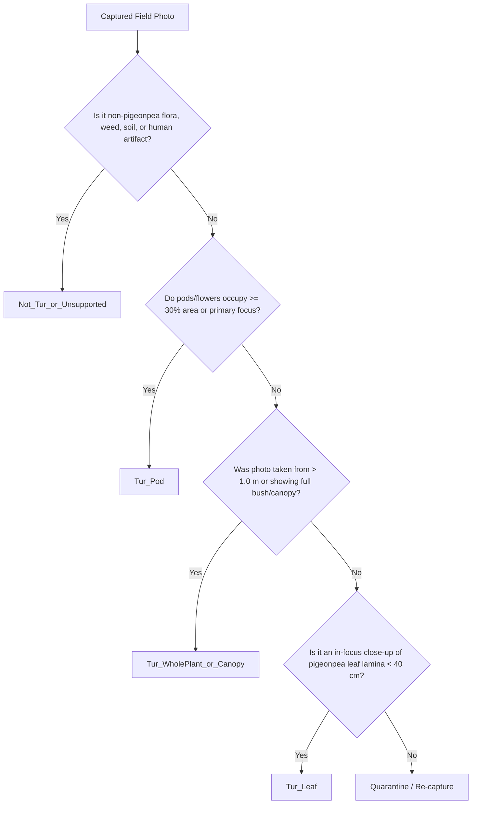

# TurSathi AI — Phase 5D Field Collection Protocol Briefing Document

**Document Title:** Standard Operating Procedure & Field Collection Protocol for Pigeonpea Organ Validation Dataset  
**Phase:** Phase 5D-B4  
**Date:** 2026-10-14  
**Status:** Operational Protocol (Approved for Field Teams and Agronomists)  
**Associated Tools:**
* Design Report: [`reports/pigeonpea_organ_validator_design/PHASE5D_A_DESIGN_REPORT.md`](file:///c:/Users/admin/OneDrive/Documents/Desktop/TurSathi%20AI/reports/pigeonpea_organ_validator_design/PHASE5D_A_DESIGN_REPORT.md)
* Field Checklist: [`reports/pigeonpea_organ_dataset_collection/PHASE5D_B3_FIELD_COLLECTION_CHECKLIST.md`](file:///c:/Users/admin/OneDrive/Documents/Desktop/TurSathi%20AI/reports/pigeonpea_organ_dataset_collection/PHASE5D_B3_FIELD_COLLECTION_CHECKLIST.md)
* Metadata Template: [`reports/pigeonpea_organ_dataset_collection/field_metadata_template.csv`](file:///c:/Users/admin/OneDrive/Documents/Desktop/TurSathi%20AI/reports/pigeonpea_organ_dataset_collection/field_metadata_template.csv)
* Automated Validator: [`scripts/audits/validate_pigeonpea_field_collection.py`](file:///c:/Users/admin/OneDrive/Documents/Desktop/TurSathi%20AI/scripts/audits/validate_pigeonpea_field_collection.py)

---

## 1. Purpose and Scope of Field Collection

### 1.1 The Operational Problem
The current TurSathi AI production disease model was trained on close-up pigeonpea (*Cajanus cajan*) leaf imagery to classify 5 specific foliar conditions (`Healthy`, `Leaf_Spot`, `Leaf_webber`, `Sterilic_mosaic`, `Wilt`). Exploratory stress testing revealed that when farmers photograph non-leaf plant parts—such as green/brown pod clusters, flower racemes, whole bushes, or distant canopies—the disease classifier often forces an out-of-distribution (OOD) prediction, most commonly predicting `Wilt` with high false confidence.

While the current `TurImageGate` effectively filters non-crop images and severe blur, it evaluates crop identity at the plant species level (`Tur` vs `Not_Tur`), not the organ level.

### 1.2 Purpose of this Protocol
This briefing document provides clear, standardized, and agronomically grounded instructions for field photographers, extension personnel, and agronomists to collect an authentic, non-synthetic dataset of pigeonpea reproductive structures, whole-plant canopies, and field distractors. This data will be used to train and validate the **Phase 5D Organ Validator** (`TurOrganValidator`), ensuring that only suitable close-up leaf photographs reach the disease classifier.

---

## 2. Four Annotation Classes & Hierarchy Rules

To eliminate annotator confusion and class overlap, all collected images must strictly conform to the 4 canonical classes established in [`reports/pigeonpea_organ_validator_design/PHASE5D_A_DESIGN_REPORT.md`](file:///c:/Users/admin/OneDrive/Documents/Desktop/TurSathi%20AI/reports/pigeonpea_organ_validator_design/PHASE5D_A_DESIGN_REPORT.md):



### Class Definitions and Routing Rules

| Class Label | Morphological Definition | Framing & Area Rule | Target Pipeline Routing |
| :--- | :--- | :--- | :--- |
| **`Tur_Leaf`** | Close-up view of pigeonpea foliar tissue suitable for disease diagnosis. | Leaf lamina clearly resolvable; individual leaflet or small cluster occupying $\ge 60\%$ of foreground area. | **PASS** to 5-Class Disease Predictor |
| **`Tur_Pod`** | Reproductive structures: green developing pods, striated pods, mature brown pods, or flower racemes. | Pods or flowers occupy $\ge 30\%$ of foreground area or form primary focal point. | **REJECT** with HTTP 422: *"Pigeonpea pods detected. Pod borer/blight diagnosis will be available in Phase 6."* |
| **`Tur_WholePlant_or_Canopy`** | Full bush architecture, branch structure, lateral canopy spread, or distant landscape rows. | Entire shrub or canopy view; individual leaf laminae occupy $< 15\%$ of image area. | **REJECT** with HTTP 422: *"Distant whole-plant shot detected. Please hold your camera 20-30 cm away from an individual leaf."* |
| **`Not_Tur_or_Unsupported`** | Non-pigeonpea agricultural subjects, intercrops, weeds, soil, hands, farm tools. | Companion crops (cotton, soybean, sorghum), field weeds (parthenium), bare soil, non-agricultural items. | **REJECT** with HTTP 422: *"Unsupported subject. Please upload a clear Tur/Pigeonpea leaf image."* |

---

## 3. Practical Photo-Capture & Camera Guidance

### 3.1 Documented Camera Distance Guidelines

All field photographers must adhere to the documented distance parameters:

* **`Tur_Leaf`:** Documented distance is **$< 40\text{ cm}$** (recommended working distance: **$20\text{ cm} - 30\text{ cm}$**). Leaf surface must be in sharp focus with distinct vein structure visible.
* **`Tur_Pod`:** Documented distance is **$15\text{ cm} - 35\text{ cm}$**. The camera lens must focus directly on the pod surface or cluster.
* **`Tur_WholePlant_or_Canopy`:** Documented distance is **$> 1.0\text{ meter}$** (recommended working distance: **$1.0\text{ m} - 2.5\text{ meters}$**).
* *Provisional Distances Note:* Any distance outside these ranges (e.g. macro $< 10\text{ cm}$ or drone/landscape $> 5\text{ meters}$) is considered provisional and must be flagged as experimental in `notes`.

### 3.2 Lighting and Environmental Controls
* **Optimal Hours:** Photograph strictly between **8:30 AM and 4:30 PM** under natural ambient sunlight.
* **Avoid Lens Flare:** Never shoot with the lens pointing directly toward the sun. Position yourself so sunlight illuminates the target organ from the side or behind the photographer.
* **Avoid Operator Shadowing:** Ensure the photographer’s body, smartphone shadow, or hat shadow does not fall across the focal plant tissue.
* **Wind Stability:** Pigeonpea shrubs can sway heavily in farm wind. Wait for a lull in wind before tapping the shutter, or gently support the branch stem outside the camera frame without obscuring the target organ.

### 3.3 Resolution, Focus, and Background
* **Resolution Floor:** The native image gate rejects inputs below $224 \times 224$ pixels. Field cameras must shoot at native smartphone resolution ($\ge 1280 \times 720$, ideally $1920 \times 1080$ or $4000 \times 3000$).
* **No Software Distortion:** Disable portrait mode, software background blur (bokeh simulation), AI beautification, and digital zoom. Optical lens capture only.
* **Natural Agricultural Backgrounds:** Backgrounds must be authentic field contexts (soil, neighboring branches, companion crops, sky). Do not place artificial white poster boards or black sheets behind branches; the validator must learn natural farm backgrounds.

### 3.4 Duplicate-Photo Prevention (Critical)
The automated validator enforces strict SHA-256 cryptographic uniqueness:
* **No Burst Mode:** Do not take rapid continuous burst shots from the identical position.
* **Angular Variation:** To capture multiple photos from the same plant, take at most 2–3 photos per shrub, repositioning your stance by at least $45^\circ$ or targeting distinct branches.
* **No File Renaming Duplicates:** Copying and renaming the same image file will be detected and rejected by `validate_pigeonpea_field_collection.py`.

---

## 4. Metadata Schema & Manifest Logging Rules

All captures must be recorded in real-time into a CSV file following [`reports/pigeonpea_organ_dataset_collection/field_metadata_template.csv`](file:///c:/Users/admin/OneDrive/Documents/Desktop/TurSathi%20AI/reports/pigeonpea_organ_dataset_collection/field_metadata_template.csv).

### 4.1 Required Columns (Mandatory)
The automated validator will reject manifests if any of the following columns are missing or contain empty values:

| Column Name | Allowed Values / Format | Description & Validation Rule |
| :--- | :--- | :--- |
| `filename` | String (e.g. `F01_POD_001.jpg`) | Exact image filename existing in `--image-dir`. Must be unique across manifest. |
| `class_label` | One of: `Tur_Pod`, `Tur_WholePlant_or_Canopy`, `Tur_Leaf`, `Not_Tur_or_Unsupported` | Canonical category. Unrecognized values cause validation failure. |
| `plant_id` | String (e.g. `F01_P001`) | Identifies the physical shrub. Photos of the same shrub must share `plant_id`. |
| `farm_id` | String (e.g. `FARM_MAH_01`) | Identifies the farm plot. Must represent a geographically distinct parcel. |
| `capture_date` | `YYYY-MM-DD` (e.g. `2026-10-20`) | Date photo was taken in the field. |
| `verification_status` | One of: `verified`, `quarantined`, `rejected` | Current review status. Only `verified` counts toward targets. |
| `verifier_reference` | String | Agronomist credential or reference (e.g. `Dr. A. Sharma (#AG-104)`). If pending, use `Pending Agronomist Review`. |

### 4.2 Optional Supporting Columns
The following columns are supported by the template to improve scientific traceability:
* `growth_stage`: e.g. `vegetative`, `flowering`, `pod_filling`, `pod_maturity`, `senescence`.
* `camera_device`: e.g. `Redmi_Note_11`, `Samsung_Galaxy_M32`, `Vivo_Y20`.
* `lighting_condition`: e.g. `bright_sunlight`, `diffuse_overcast`, `partial_shadow`.
* `notes`: Relevant field observations (e.g. `mottled pod cluster`, `intercropped with cotton`).
* `split`: Optional partition tag (`train`, `val`, `test`). Used by validator to check for plant/farm leakage.

---

## 5. Farm Plot Separation & Split Leakage Prevention

To ensure robust generalization across varying micro-climates, soils, and cultivars:

1. **Farm Separation Requirement:** The dataset must span **at least 5 geographically distinct farm plots**, separated by **at least 5 kilometers** (e.g. across Marathwada, Vidarbha, or regional pulses belts).
2. **Cultivar Diversity:** Field teams should document local pigeonpea varieties across plots (e.g. BDN-711, BSMR-736, PKV-Tara, Maruti, Asha).
3. **Plant-Level Leakage Prevention:**
   * Images sharing the same `plant_id` or `farm_id` must **never** be split across training and evaluation partitions.
   * If `F01_P001` photos appear in `train`, no photo from `F01_P001` may appear in `val` or `test`.
   * The automated validation utility (`validate_pigeonpea_field_collection.py`) will automatically flag cross-split contamination as a fatal blocker.
4. **Privacy Protection:** Strip exact GPS household coordinates from image EXIF metadata prior to ingestion. Use plot identifiers (`FARM_MAH_01`). Ensure no farmer faces, bystanders, or vehicle license plates are visible in photos.

---

## 6. Agronomist Verification and Sign-Off Procedure

> [!IMPORTANT]
> **Strict Verification Standard:**
> No record may be marked `verification_status = "verified"` without independent visual inspection and affirmative sign-off by a qualified agronomist or plant pathologist. **Never invent, simulate, or mock credentials.** Current verified progress is 0.

### 6.1 Verification Criteria
The reviewing agronomist must confirm three items before marking an image as `verified`:
1. **Species Authenticity:** The plant is confirmed as *Cajanus cajan* (pigeonpea/tur).
2. **Organ Categorization:** The framing unambiguously fits the category definition without borderline dominance.
3. **Diagnostic Usability:** The image is free of severe motion blur, lens flare, or extreme underexposure.

### 6.2 Status Assignment Rules
* **`verified`:** Unambiguously meets all three criteria. Verifier enters their official name and credential reference in `verifier_reference`.
* **`quarantined`:** Ambiguous framing (e.g. pods and leaves equally prominent), borderline distance ($0.8\text{ m}$), or uncertain species. The image is moved to a quarantine staging pool. Quarantined records **do not count** toward targets.
* **`rejected`:** Severe blur, extreme glare, damaged file, accidental duplicate, or uncorrectable defect. Permanently excluded from training.

---

## 7. Quantitative Collection Targets

Before dataset readiness can be certified for model training, the collection must reach the following minimum empirical targets:

| Category | Minimum Verified Target | Current Verified Count | Outstanding Deficit |
| :--- | :---: | :---: | :---: |
| **`Tur_Pod`** | **$\ge 250$ verified** | 0 | **-250** |
| **`Tur_WholePlant_or_Canopy`** | **$\ge 200$ verified** | 0 | **-200** |
| **`Not_Tur_or_Unsupported`** | **$\ge 100$ verified** | 0 | **-100** |
| **Distinct Farm Plots** | **$\ge 5$ qualifying plots** | 0 | **-5** |

*Note on `Tur_Leaf`:* Existing project datasets already possess $\sim 1,800$ verified close-up leaf photographs. Therefore, collection priority is focused on `Tur_Pod`, `Tur_WholePlant_or_Canopy`, and negative distractors. If new field leaves are photographed, they must be verified under the same protocol.

---

## 8. Explicit Policy Regarding Leaf & Disease Images

> [!CAUTION]
> **Disease Dataset Separation Rule:**
> * Existing pigeonpea disease images from `datasets/pigeonpea_disease_final/` must **NOT** be copied into the field collection manifest without independent agronomic re-verification.
> * Close-up leaf images collected in this campaign must be clearly labeled `Tur_Leaf`. They must **NOT** be assigned disease classifications (such as `Wilt` or `Leaf_Spot`) unless a verified pathology diagnosis is certified by the agronomist.
> * Misrepresenting unverified leaf photos as pathology benchmarks undermines model safety.

---

## 9. Common Collection Mistakes & How to Correct Them

| Common Field Mistake | Consequence | Corrective Action |
| :--- | :--- | :--- |
| **Equal leaf/pod framing:** Photographing a branch where 3 leaves and 3 pods share the focal plane. | Annotator ambiguity and label noise. | Apply the **Reproductive Priority Rule:** If pods occupy $\ge 30\%$ area or form primary focus, label `Tur_Pod`. If ambiguous, mark `quarantined`. |
| **Burst captures of the same plant:** Taking 10 quick shots of the same pod cluster without moving. | Duplicate hash rejection or high validation bias. | Limit to 2–3 shots per shrub. Move your position by $\ge 45^\circ$ between shots. |
| **Shooting into direct sun:** Strong backlighting causing pod silhouette and lens flare. | Image rejected by Laplacian blur or quality gate. | Reposition so sunlight falls on the plant surface from the side or behind the photographer. |
| **Distant shot labeled as pod:** Photographing an entire bush from 2 meters away and calling it `Tur_Pod` because small pods are visible. | Semantic confusion for whole-plant classifier. | Apply the **Distance Guard:** If distance $> 1\text{ meter}$, label `Tur_WholePlant_or_Canopy`. |
| **Capturing farmer faces or hands:** Holding a pod with a visible human hand. | Privacy violation and non-plant artifact intrusion. | Frame the pod on the natural stem. Do not hold it with fingers in the frame. |

---

## 10. Audit Commands for Manifest Verification

Once photos and the manifest have been assembled, execute these actual CLI commands from the repository root:

### Step 1: Manifest Schema & Progress Audit (Dry-Run)
Checks columns, class labels, statuses, and counts without requiring image files:
```powershell
python scripts/audits/validate_pigeonpea_field_collection.py `
  --manifest datasets/pigeonpea_field_collection/field_manifest.csv `
  --no-image-check
```

### Step 2: Full Image Verification, Decode & Deduplication Audit
Inspects physical image files, verifies PIL decode, checks $224\times 224$ resolution floor, calculates SHA-256 hashes, and detects cross-split leakage:
```powershell
python scripts/audits/validate_pigeonpea_field_collection.py `
  --manifest datasets/pigeonpea_field_collection/field_manifest.csv `
  --image-dir datasets/pigeonpea_field_collection/images/
```

### Step 3: Export Machine-Readable Audit Report
Generates an audit JSON file documenting exact deficit counts, issues, and readiness state:
```powershell
python scripts/audits/validate_pigeonpea_field_collection.py `
  --manifest datasets/pigeonpea_field_collection/field_manifest.csv `
  --image-dir datasets/pigeonpea_field_collection/images/ `
  --json-out reports/pigeonpea_organ_dataset_collection/field_audit_summary.json
```

---

## 11. Assumptions & Items Needing Agronomist Confirmation

Before field teams deploy, the following technical assumptions should be formally reviewed with the participating agronomist:

1. **Pod Maturation Coverage:** Confirm whether both green immature pods (flowering stage) and desiccant/brown harvest pods should be equally sampled across all 5 farm plots. *(Assumption: Equal distribution is desired to prevent seasonal bias).*
2. **Cultivar Morphological Variance:** Confirm whether red/purple mottled pods (common in cultivars like BDN-711) require specific sub-class notes to avoid misclassification against dark fungal spots.
3. **Agronomist Credential Format:** Confirm the acceptable professional identifier format for `verifier_reference` (e.g. State Agricultural University extension ID, KVK officer registration, or institutional email).
4. **Distance Boundaries Calibration:** Confirm whether the $15\text{ cm}-35\text{ cm}$ pod distance and $>1.0\text{ m}$ whole-plant distance remain agronomically intuitive for standard shrub heights ($1.5\text{ m}-2.5\text{ m}$) across all target plots.

---

## 12. Verification & System Preservation

This document is an operational field briefing. We explicitly confirm:
* **Current Verified Progress:** Strictly **0 (Zero)**. No field data has been collected or fabricated.
* **Production Disease Model:** Intact and preserved.
* **Working-Tree Integrity:** All existing working-tree changes remain preserved.
* **Organ Validator Feature Flag:** `ENABLE_ORGAN_VALIDATOR` remains disabled (`False`).
