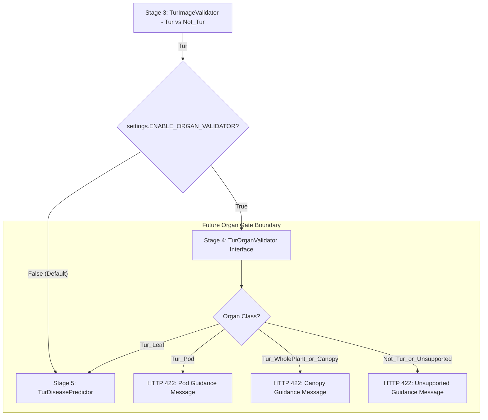
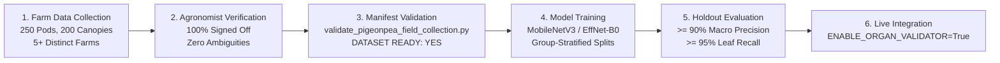

# TurSathi AI — Phase 5D Step 3: Offline Organ Validator Integration Test Plan

**Document Version:** 1.0  
**Phase:** Phase 5D-B5 (Offline Integration Planning)  
**Date:** 2026-10-14  
**Project:** TurSathi AI / AgriMind AI  
**Scope:** Formal engineering test plan and architectural integration specification for future activation of the Organ Validator (`TurOrganValidator`) within the image validation and disease prediction pipeline.

---

## 1. Executive Summary & Non-Integration Status

### 1.1 Explicit Non-Integration Confirmation
As of Phase 5D Step 3, **the Organ Validator is strictly an offline interface stub and is NOT integrated into the operational inference pipeline**:
* **Live Pipeline Untouched:** Neither [`backend/app/ml/tur_image_gate.py`](file:///c:/Users/admin/OneDrive/Documents/Desktop/TurSathi%20AI/backend/app/ml/tur_image_gate.py) nor [`backend/app/services/prediction_service.py`](file:///c:/Users/admin/OneDrive/Documents/Desktop/TurSathi%20AI/backend/app/services/prediction_service.py) imports or executes `TurOrganValidator`.
* **Feature Flag Disabled:** `ENABLE_ORGAN_VALIDATOR` is strictly configured to `False` in [`backend/app/core/config.py`](file:///c:/Users/admin/OneDrive/Documents/Desktop/TurSathi%20AI/backend/app/core/config.py).
* **Zero Model Weights:** No trained checkpoint (`models/tur_organ_validator_*.pth`) exists on disk.
* **Zero Verified Field Records:** Authentic field collection stands at exactly 0 images across all target categories (`Tur_Pod`, `Tur_WholePlant_or_Canopy`, `Not_Tur_or_Unsupported`).

### 1.2 Purpose of this Plan
This document defines the exact test suite, validation gates, error boundaries, acceptance criteria, and rollback mechanisms required before any future pull request may safely enable the Organ Validator in staging or production environments.

---

## 2. Current Architecture vs. Future Integration Sequence

### 2.1 Current Production Flow (Preserved & Active)

```mermaid
graph TD
    A[Client Upload / POST /api/v1/scans] --> B[Store Image on Disk & Create TurScan Record]
    B --> C[Prediction Request / POST /api/v1/predictions/tur-leaf/{scan_id}]
    C --> D[PredictionService.run_prediction]
    D --> E[TurImageGate.validate]
    
    subgraph Current Active Gate
        E --> G1[1. Resolution Floor: width, height >= 224px]
        G1 --> G2[2. Sharpness: Laplacian variance >= 35.0]
        G2 --> G3[3. Crop Gate: TurImageValidator - Tur vs Not_Tur]
    end
    
    G3 -- Not_Tur --> R1[HTTP 422: Validation Failed]
    G3 -- Tur --> F[TurDiseasePredictor.predict: 5-Class EfficientNet-B0]
    F --> H[Confidence Check >= 0.65]
    H -- Pass --> S[Persist Disease Result to DB -> HTTP 200]
    H -- Fail --> R2[HTTP 422: Unsupported Disease]
```

### 2.2 Future Target Pipeline Flow (Feature-Flagged Stage 4)

When `ENABLE_ORGAN_VALIDATOR = True` is activated in the future, the pipeline will execute as a hierarchical 5-stage filter:



---

## 3. Safe Adapter Boundary Specification

To prevent breaking existing API contracts and database persistence logic, the Organ Validator must communicate with `TurImageGate` through an isolated adapter pattern.

### 3.1 Field Translation Contract
The adapter translates [`OrganValidationResult`](file:///c:/Users/admin/OneDrive/Documents/Desktop/TurSathi%20AI/backend/app/ml/tur_organ_validator.py) into [`ValidationResult`](file:///c:/Users/admin/OneDrive/Documents/Desktop/TurSathi%20AI/backend/app/ml/tur_image_gate.py):

| `OrganValidationResult` Field | Mapped `ValidationResult` Field | Mapping Rule & Rationale |
| :--- | :--- | :--- |
| `is_valid_leaf` (`bool`) | `is_valid_tur` (`bool`) | Only `Tur_Leaf` passing the confidence threshold is valid for disease prediction. |
| `organ_class` (`str`) | `label` (`str`) | Canonical class string (`Tur_Leaf`, `Tur_Pod`, `Tur_WholePlant_or_Canopy`, `Not_Tur_or_Unsupported`). |
| `confidence` (`float`) | `confidence` (`float`) | Pass-through softmax probability. |
| `reason` (`str`) | `reason` (`str`) | Machine-readable outcome token (`organ_verified_leaf`, `organ_rejected_pod`, etc.). |
| `user_message` (`Optional[str]`) | `message` (`Optional[str]`) | Farmer guidance string formatted for HTTP 422 response. |
| `raw_probabilities` (`dict`) | *(Excluded)* | **Strictly dropped.** Never passed to `ValidationResult` or serialized into public API responses. |

### 3.2 Downstream Safety Guarantee
Because `TurImageGate.validate()` will continue returning a standard `ValidationResult`, [`PredictionService`](file:///c:/Users/admin/OneDrive/Documents/Desktop/TurSathi%20AI/backend/app/services/prediction_service.py) requires **zero changes**:
```python
# PredictionService continues executing existing logic:
if not gate_result.is_valid_tur:
    scan.status = "rejected"
    scan.prediction_status = "rejected"
    db.commit()
    raise HTTPException(
        status_code=status.HTTP_422_UNPROCESSABLE_ENTITY,
        detail={
            "status": "validation_failed",
            "message": gate_result.message or "This image does not appear to be a valid Tur leaf."
        }
    )
```

---

## 4. Expected System Behavior Under Failure & Edge Cases

The following matrix defines the mandatory system behaviors across all operational scenarios:

| Scenario | Input Condition | Expected Pipeline Action | HTTP Status Code | Returned Payload / Log |
| :--- | :--- | :--- | :---: | :--- |
| **Normal Production (Current)** | `ENABLE_ORGAN_VALIDATOR = False` | Completely bypasses organ validation; evaluates resolution, blur, and crop gate only. | `200 OK` or `422` | Standard crop validation outcome. Zero organ gate overhead. |
| **Valid Pigeonpea Leaf** | Organ model predicts `Tur_Leaf` with $\ge 0.70$ confidence. | Passes Stage 4; proceeds directly to `TurDiseasePredictor`. | `200 OK` | `PredictionResponse(disease_name=..., confidence=...)`. |
| **Pigeonpea Pod Detected** | Organ model predicts `Tur_Pod` ($\ge 30\%$ area). | Rejection at Stage 4; image marked as rejected in database. | `422 Unprocessable` | `{"status": "validation_failed", "message": "Pigeonpea pods detected. Pod borer/blight diagnosis will be available in Phase 6. Please upload a close-up photo of an individual leaf."}` |
| **Whole Canopy Detected** | Organ model predicts `Tur_WholePlant_or_Canopy`. | Rejection at Stage 4; image marked as rejected in database. | `422 Unprocessable` | `{"status": "validation_failed", "message": "Distant whole-plant or canopy view detected. Please hold your camera 20-30 cm away from an individual leaf so leaf symptoms can be clearly examined."}` |
| **Negative Distractor** | Organ model predicts `Not_Tur_or_Unsupported`. | Rejection at Stage 4; image marked as rejected in database. | `422 Unprocessable` | `{"status": "validation_failed", "message": "Image does not appear to be a pigeonpea leaf. Please upload a clear Tur leaf photo."}` |
| **Unconfigured Model (Weights Missing)** | `ENABLE_ORGAN_VALIDATOR = True`, but model weights file is absent or corrupted. | `TurOrganValidator` raises `OrganModelNotConfiguredError`. Gate catches exception, logs warning, and rejects safely. | `422 Unprocessable` | Rejection with `reason="organ_validator_unconfigured"`. Never crashes with unhandled 500. Never invents fake scores. |
| **Unexpected Runtime Error** | GPU driver failure, CUDA OOM, or memory corruption during organ inference. | Gate error boundary catches `Exception`, logs warning, rejects image safely. | `422 Unprocessable` | Rejection with `reason="organ_validator_runtime_error"` and user guidance to re-upload. |

---

## 5. Prerequisite Test Data & Model Milestones

Before live pipeline integration may be authorized, the following empirical milestones must be satisfied and certified:



### Detailed Milestone Gate Criteria:
1. **Physical Field Collection Quota:**
   * $\ge 250$ verified `Tur_Pod` images.
   * $\ge 200$ verified `Tur_WholePlant_or_Canopy` images.
   * $\ge 100$ verified `Not_Tur_or_Unsupported` negative distractors.
   * Collected across $\ge 5$ geographically separated farms ($\ge 5\text{ km}$ apart).
2. **Agronomist Credentialed Verification:**
   * 100% of manifest records must have `verification_status = "verified"` and valid `verifier_reference`.
   * Exactly 0 unresolved records in quarantine (`quarantined_records == 0`).
3. **Automated Manifest Certification:**
   * Execution of [`scripts/audits/validate_pigeonpea_field_collection.py`](file:///c:/Users/admin/OneDrive/Documents/Desktop/TurSathi%20AI/scripts/audits/validate_pigeonpea_field_collection.py) must exit with code `0` and display `DATASET READY FOR TRAINING: YES [APPROVED]`.
4. **Offline Holdout Performance Targets:**
   * Macro Precision across organ classes $\ge 90.0\%$.
   * `Tur_Leaf` Sensitivity / Recall $\ge 95.0\%$ (no more than 5% false rejections on genuine leaf photos).
   * Cross-split plant leakage strictly $0.0\%$.

---

## 6. Offline vs. Future Test Execution Matrix

This matrix establishes what can be validated immediately versus what must await physical farm data:

| Test Category | Test File / Command | Current Status | Requires Real Field Photos? |
| :--- | :--- | :---: | :---: |
| **Interface Defaults & Classes** | `backend/tests/test_tur_organ_validator_interface.py` | **PASSED (8/8)** | **No** (Unit test fixtures) |
| **Quality Gate Heuristics** | `backend/tests/test_tur_image_gate_quality.py` | **PASSED (7/7)** | **No** (Synthetic test images) |
| **Adapter Mapping Contract** | `backend/tests/test_tur_organ_validator_adapter.py` | **PASSED (7/7)** | **No** (Mock dataclass objects) |
| **Error Handling & Boundaries** | `backend/tests/test_tur_organ_validator_error_handling.py` | **PASSED (7/7)** | **No** (Mock exceptions) |
| **Manifest Audit & CLI Tests** | `tests/test_pigeonpea_field_collection_validator.py` | **PASSED (9/9)** | **No** (Synthetic CSV fixtures) |
| **Stress Runner Boundaries** | `tests/test_pigeonpea_web_image_stress.py` | **PASSED (3/3)** | **No** (Audited stress set) |
| **Real Pod Rejection Rate** | *Future: `test_organ_pod_rejection_eval.py`* | **PENDING** | **YES** ($\ge 250$ verified field pods) |
| **Real Canopy Rejection Rate** | *Future: `test_organ_canopy_rejection_eval.py`* | **PENDING** | **YES** ($\ge 200$ verified field canopies) |
| **Real Leaf Pass-Through Rate** | *Future: `test_organ_leaf_sensitivity_eval.py`* | **PENDING** | **YES** (Field leaf benchmark) |
| **Live Route End-to-End Test** | *Future: `test_predictions_with_organ_gate.py`* | **PENDING** | **YES** (Trained model weights) |

---

## 7. Acceptance Criteria and Rollback Procedures

### 7.1 Stage 4 Activation Acceptance Criteria
Before setting `ENABLE_ORGAN_VALIDATOR = True` in any deployment environment:
1. All 41 unit, regression, adapter, and error-handling tests must pass with a 100% pass rate.
2. The certified organ checkpoint must exist in `models/` with its SHA-256 hash verified.
3. Cold inference latency on GPU must not exceed $45\text{ ms}$ ($120\text{ ms}$ on CPU).
4. False-positive rejection rate on the existing 1,858 clean leaf images must be verified at $\le 2.0\%$.

### 7.2 Zero-Downtime Rollback Procedure
If the Organ Validator exhibits unexpected classification drift or false rejections in staging or production:
1. **Immediate Action:** Set `ENABLE_ORGAN_VALIDATOR=False` in `backend/.env` (or environment configuration).
2. **Restart Service:** Restart the Uvicorn application process (`uvicorn app.main:app`).
3. **Safety Guarantee:** The pipeline instantly reverts to the proven Phase 5C behavior (`TurImageGate` quality + binary crop gate). No database rollback, migration rollback, or code reversion is required.

---

## 8. Verification & System Preservation Statement

* **Documentation Only:** This plan creates an engineering roadmap and modifies zero executable code.
* **Production Disease Checkpoint:** `models/best_pigeonpea_disease_final_efficientnet_b0.pth` (SHA-256 `5baecdc3911502c4cb345101c6f2fd84824eb4cb025e300d66e00231a4834b99`) remains intact and unmodified.
* **Pre-existing Working-Tree State:** Uncommitted changes in [`backend/app/api/v1/predictions.py`](file:///c:/Users/admin/OneDrive/Documents/Desktop/TurSathi%20AI/backend/app/api/v1/predictions.py), [`backend/app/ml/tur_image_gate.py`](file:///c:/Users/admin/OneDrive/Documents/Desktop/TurSathi%20AI/backend/app/ml/tur_image_gate.py), and [`backend/requirements.txt`](file:///c:/Users/admin/OneDrive/Documents/Desktop/TurSathi%20AI/backend/requirements.txt) are preserved.
* **Feature Flag:** `ENABLE_ORGAN_VALIDATOR` remains disabled (`False`).
