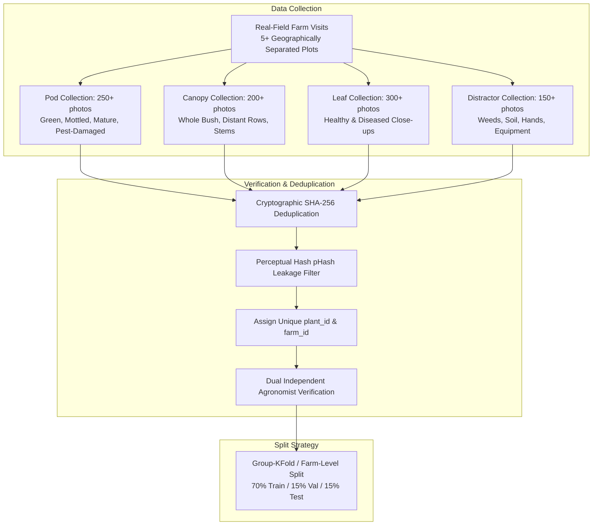
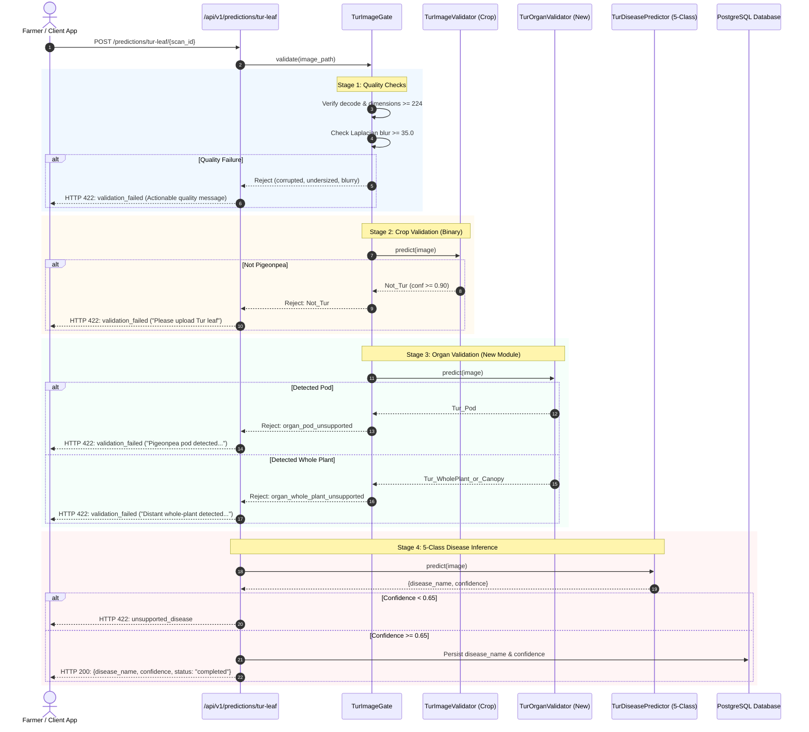

# TurSathi AI — Phase 5D-A: Organ Validator Design and Dataset Readiness Audit

**Audit Date:** 2026-10-14  
**Project:** TurSathi AI  
**Scope:** Architectural design and dataset readiness audit for an organ-level validation stage (Leaf vs. Non-Leaf / Pod / Whole-Plant).  
**Phase Objective:** AUDIT AND DESIGN ONLY. Zero model training, zero dataset modification, and zero code implementation.

---

## Executive Summary

Phase 5A exploratory stress testing demonstrated that both the production and experimental 5-class pigeonpea disease classifiers frequently collapse into high-confidence **Wilt** predictions ($>0.97$) when exposed to non-leaf pigeonpea organs (seed pods, woody stems, whole bushes) and out-of-distribution (OOD) scientific figures. Phase 5B determined that the root cause is the lack of organ-level discrimination in the binary crop validator (`TurImageValidator`), which only determines whether plant tissue is pigeonpea (`Tur` vs. `Not_Tur`). Phase 5C safely introduced resolution and blur heuristics into [`backend/app/ml/tur_image_gate.py`](file:///c:/Users/admin/OneDrive/Documents/Desktop/TurSathi%20AI/backend/app/ml/tur_image_gate.py), but acknowledged that deterministic quality heuristics cannot distinguish an in-focus pod or whole bush from an in-focus leaf.

This Phase 5D-A audit evaluates the design of a dedicated organ-validation stage. We examine candidate class definitions, evaluate flat vs. hierarchical architectures, inventory repository datasets, identify severe data deficits (specifically pods and authentic whole-canopy shots), establish leakage-proof partitioning rules, and define unambiguous Go/No-Go criteria required before any training or code integration can proceed.

**Zero code, model checkpoints, training datasets, database records, API contracts, frontend files, or mobile screens were modified in this phase.**

---

## 1. Files and Artifacts Inspected

The following source code and audit reports were independently inspected in detail:

1. **Gate and Validator Implementations:**
   - [`backend/app/ml/tur_image_gate.py`](file:///c:/Users/admin/OneDrive/Documents/Desktop/TurSathi%20AI/backend/app/ml/tur_image_gate.py): Implements PIL decode verification, resolution floor (`MIN_IMAGE_DIMENSION = 224`), Laplacian variance blur heuristic (`BLUR_THRESHOLD = 35.0`), and delegates to `TurImageValidator`.
   - [`backend/app/ml/tur_image_validator.py`](file:///c:/Users/admin/OneDrive/Documents/Desktop/TurSathi%20AI/backend/app/ml/tur_image_validator.py): EfficientNet-B0 binary model evaluating `["Not_Tur", "Tur"]` based on `models/tur_image_validator_efficientnet_b0_v3.pth`.
   - [`backend/app/ml/tur_predictor.py`](file:///c:/Users/admin/OneDrive/Documents/Desktop/TurSathi%20AI/backend/app/ml/tur_predictor.py): Production 5-class EfficientNet-B0 disease classifier (`Healthy`, `Leaf_Spot`, `Leaf_webber`, `Sterilic_mosaic`, `Wilt`).
   - [`backend/app/services/prediction_service.py`](file:///c:/Users/admin/OneDrive/Documents/Desktop/TurSathi%20AI/backend/app/services/prediction_service.py): Orchestrates sequential validation $\to$ prediction $\to$ confidence filtering ($< 0.65$ threshold) $\to$ database transaction.
2. **Prior Audit & Stress Test Reports:**
   - [`reports/pigeonpea_leaf_gate_audit/LEAF_GATE_AUDIT.md`](file:///c:/Users/admin/OneDrive/Documents/Desktop/TurSathi%20AI/reports/pigeonpea_leaf_gate_audit/LEAF_GATE_AUDIT.md): Detailed trace of OOD collapse to Wilt and identification of the missing organ gate.
   - [`reports/pigeonpea_leaf_gate_phase5c/PHASE5C_IMPLEMENTATION_REPORT.md`](file:///c:/Users/admin/OneDrive/Documents/Desktop/TurSathi%20AI/reports/pigeonpea_leaf_gate_phase5c/PHASE5C_IMPLEMENTATION_REPORT.md): Documentation of Phase 5C quality heuristics and remaining limitations.
   - [`reports/pigeonpea_web_image_stress_v1/WEB_IMAGE_STRESS_TEST_REPORT.md`](file:///c:/Users/admin/OneDrive/Documents/Desktop/TurSathi%20AI/reports/pigeonpea_web_image_stress_v1/WEB_IMAGE_STRESS_TEST_REPORT.md): Empirical evidence of 95.1% collapse to Wilt on uncurated web images.
   - [`backend/tests/ood_evaluation_report.txt`](file:///c:/Users/admin/OneDrive/Documents/Desktop/TurSathi%20AI/backend/tests/ood_evaluation_report.txt): Log showing 133/133 rejection of non-tur crops, but 39/41 bypass of non-leaf pigeonpea images.
   - [`reports/stage_reports/stage_f28_report.md`](file:///c:/Users/admin/OneDrive/Documents/Desktop/TurSathi%20AI/reports/stage_reports/stage_f28_report.md): Historical record documenting the HOLD on open-world release due to Wilt test-set synthetic leakage and CAT-4 exploratory foliage bypass.
   - [`reports/data/v3_dataset_manifest.csv`](file:///c:/Users/admin/OneDrive/Documents/Desktop/TurSathi%20AI/reports/data/v3_dataset_manifest.csv): Manifest of 3,561 validator images across `Tur` and `Not_Tur`.
   - [`reports/new_disease_images_audit/image_inventory.csv`](file:///c:/Users/admin/OneDrive/Documents/Desktop/TurSathi%20AI/reports/new_disease_images_audit/image_inventory.csv): Forensic inventory of the 42 exploratory web images.
3. **Regression Test Suites:**
   - [`backend/tests/test_tur_image_gate_quality.py`](file:///c:/Users/admin/OneDrive/Documents/Desktop/TurSathi%20AI/backend/tests/test_tur_image_gate_quality.py): Unit test suite for Phase 5C quality heuristics.
   - [`backend/tests/test_tur_image_gate.py`](file:///c:/Users/admin/OneDrive/Documents/Desktop/TurSathi%20AI/backend/tests/test_tur_image_gate.py): Isolated baseline fixture test.
   - [`backend/tests/test_end_to_end_pipeline.py`](file:///c:/Users/admin/OneDrive/Documents/Desktop/TurSathi%20AI/backend/tests/test_end_to_end_pipeline.py): Full integration suite testing scan intake, rejection, and prediction.

---

## 2. Organ-Validation Class Design & Architectural Trade-Offs

### A. Evaluation of the Proposed 4-Class Taxonomy

The user proposed evaluating a 4-class design:
1. `Tur_Leaf`
2. `Tur_Pod`
3. `Tur_NonLeaf` (stems, whole plants, distant views)
4. `Not_Tur_or_Unsupported` (other crops, weeds, figures, diagrams)

#### Semantic Ambiguities & Overlaps
While theoretically appealing, manual annotation under this raw taxonomy reveals three critical ambiguities:
- **Leaf vs. Pod Overlap:** Mature pigeonpea branches frequently exhibit both pods and green leaves in the same camera frame. If an annotator sees 3 leaves and 2 pods, how should they label it? Without strict area/subject hierarchy rules, annotation noise will destabilize the decision boundary.
- **`Tur_NonLeaf` Semantic Confusion:** Naming a class `Tur_NonLeaf` is counter-intuitive when the image depicts a whole bush covered in thousands of tiny leaves. The problem with a whole bush is not the absence of leaves, but that **individual leaf surfaces are too small and distant for pathology classification**.
- **Diagnostic Routing Divergence:** Stems, root crowns, and whole bushes exhibit vastly different visual features from pods. Grouping woody stems and distant landscapes into `Tur_NonLeaf` creates an excessively high intra-class variance.

### B. Refined, Unambiguous Annotation Taxonomy

To resolve annotation collisions, we propose refining the taxonomy into four strictly bounded classes with explicit visual priority rules:

| Class Name | Definition | Visual Criterion | Target Pipeline Action |
| :--- | :--- | :--- | :--- |
| **`Tur_Leaf`** | Close-up view of pigeonpea foliar tissue suitable for disease diagnosis. | Individual leaf or small cluster ($< 3$ leaflets) occupying $\ge 60\%$ of foreground; camera distance $< 40\text{ cm}$; leaf lamina clearly resolvable. | **PASS** to 5-Class Disease Predictor |
| **`Tur_Pod`** | Reproductive structures of pigeonpea (pods, seed pods, flower racemes). | Pods or flowers occupy $\ge 30\%$ of foreground area, or form the primary focal point of the shot. | **REJECT** with HTTP 422: `"Pigeonpea pods detected. Pod borer/blight diagnosis will be available in Phase 6."` |
| **`Tur_WholePlant_or_Canopy`** | Distant canopy, whole shrub, woody branch, or dead plant where individual leaves are not cleanly resolvable. | Camera distance $> 1\text{ meter}$; whole bush, field rows, or distant foliage where individual leaf laminae occupy $< 15\%$ of image area. | **REJECT** with HTTP 422: `"Distant whole-plant shot detected. Please hold your camera 20-30 cm away from an individual leaf."` |
| **`Not_Tur_or_Unsupported`** | Non-pigeonpea vegetation, weeds, soil, hands, scientific charts, diagrams, or non-agricultural objects. | Other crops (cotton, chilli, tomato, soybean), multi-panel figures, paper text, or non-plant subjects. | **REJECT** with HTTP 422: `"Unsupported subject. Please upload a clear Tur/Pigeonpea leaf image."` |

#### Hierarchical Annotation Priority Rule (Zero-Ambiguity Rule):
1. **Rule 1 (Species & Non-Plant Guard):** If the image contains scientific text, diagrams, human hands/faces, or non-pigeonpea flora $\to$ **`Not_Tur_or_Unsupported`**.
2. **Rule 2 (Reproductive Priority):** If pigeonpea pods or flowers are prominently present in the focal area ($\ge 30\%$ area) $\to$ **`Tur_Pod`** (even if background leaves exist).
3. **Rule 3 (Distance/Scale Guard):** If the shot is taken from $> 1\text{ m}$ distance or shows an entire shrub canopy $\to$ **`Tur_WholePlant_or_Canopy`**.
4. **Rule 4 (Foliar Focus):** Only if the image presents an in-focus close-up of pigeonpea leaf laminae dominating the frame $\to$ **`Tur_Leaf`**.

---

### C. Architectural Comparison: Flat vs. Hierarchical Options

We evaluated three potential implementation architectures:

```mermaid
graph TD
    subgraph Option 1: Flat 4-Class Model
        In1[Input Image] --> Flat4[Single 4-Class Model<br>Tur_Leaf / Tur_Pod / Tur_Canopy / Not_Tur]
        Flat4 --> Routing1{Prediction}
    end

    subgraph Option 2: Hierarchical 2-Stage Pipeline (Recommended)
        In2[Input Image] --> GateQ[Stage 1: Quality Gate<br>Resolution >= 224, Blur >= 35.0]
        GateQ --> GateCrop[Stage 2: Existing Crop Gate<br>Tur vs Not_Tur MobileNetV3/EffNet]
        GateCrop -- Tur --> GateOrgan[Stage 3: New Organ Gate<br>Tur_Leaf vs Tur_Pod vs Tur_Canopy]
        GateCrop -- Not_Tur --> RejectCrop[Reject: Not Pigeonpea]
        GateOrgan -- Tur_Leaf --> Classifier[Stage 4: 5-Class Classifier<br>TurDiseasePredictor]
        GateOrgan -- Non-Leaf --> RejectOrgan[Reject: Specific Guidance]
    end

    subgraph Option 3: 3-Class Consolidated Gate
        In3[Input Image] --> Gate3[3-Class Model<br>Tur_Leaf / Tur_NonLeaf_or_Pod / Not_Tur]
        Gate3 --> Routing3{Prediction}
    end
```

| Criteria | Option 1: Flat 4-Class Model | Option 2: Hierarchical 2-Stage Gate (Recommended) | Option 3: 3-Class Consolidated Gate |
| :--- | :--- | :--- | :--- |
| **Model Structure** | 1 model (4 classes) | 2 separate models (Crop binary + Organ 3-class) | 1 model (3 classes: Leaf, NonLeaf, NotTur) |
| **Preservation of Existing Assets** | Replaces and discards the proven `tur_image_validator_v3` (which has 100% rejection on non-tur crops). | **100% Preserved:** Existing crop validator remains untouched; organ gate is an isolated second filter. | Discards existing validator; forces pods and whole plants into one broad class. |
| **Data Collection Burden** | High: requires large balanced multi-class dataset across all 4 categories simultaneously. | **Modular:** Organ model only needs pigeonpea field images; non-tur crop negative set is already mastered. | Moderate: still requires massive non-tur negative set retraining. |
| **Farmer Error Guidance** | Precise: can distinguish pods from whole plants. | **Precise & Actionable:** Can distinguish pods ("Pod diagnosis in Phase 6") from whole plants ("Take a close-up"). | Generic: cannot tell the farmer whether they photographed a pod or a distant tree. |
| **Risk of Regression** | High: Retraining non-tur crop recognition could degrade existing 100% crop rejection. | **Zero:** Existing crop boundary is protected by the upstream model. | High: Potential leakage between non-leaf pigeonpea and non-tur vegetation. |
| **Computational Overhead** | Single forward pass ($\sim 18\text{ ms}$). | Two lightweight forward passes ($\sim 35\text{ ms}$ total on CPU). | Single forward pass ($\sim 18\text{ ms}$). |

> [!TIP]
> **Architectural Recommendation: Option 2 (Hierarchical Two-Stage Pipeline).**  
> Preserving the existing `TurImageValidator` as Stage 1 ensures that no regression occurs against external crops (chilli, tomato, cotton). The new organ validator operates strictly as Stage 2 downstream, classifying confirmed pigeonpea imagery into `Tur_Leaf` vs. `Tur_Pod` vs. `Tur_WholePlant_or_Canopy`.

---

## 3. Dataset Readiness Audit

We audited all image assets across the repository without modifying any file:

### A. Repository Asset Inventory

| Dataset Directory | Total Files | Dominant Content | Usability for Organ Validator | Label Verification Status |
| :--- | :---: | :--- | :--- | :--- |
| `datasets/pigeonpea_disease_clean_candidate_v1/` | 1,676 | Close-up leaf photographs across 5 disease classes | **Prime Candidate for `Tur_Leaf`** | **VERIFIED:** Forensic audit and holdout evaluation confirmed authentic leaf imagery. |
| `datasets/pigeonpea_disease_final/` | 1,858 | Original dataset (contains exact duplicate leaks & contaminated Wilt) | **DO NOT USE** (contains known leakage and cross-class contamination). | Quarantined / Deprecated. |
| `datasets/tur_image_validator_v3/test/Not_Tur` | 133 | Verified external crop foliage (chilli, tomato, etc.) | Candidate for `Not_Tur_or_Unsupported` test holdout | **VERIFIED:** 100% ground-truth verified non-pigeonpea crops. |
| `datasets/tur_image_validator_v3/train/Not_Tur` | 1,460 | Diverse agricultural non-tur foliage | Candidate for `Not_Tur_or_Unsupported` training | Verified non-tur agricultural imagery. |
| `datasets/_temp_wilt_staging/` | 300 | 30 physical plant photos of wilted bushes + 270 augmented versions | **Partial Candidate for `Tur_WholePlant_or_Canopy`** | **UNCERTAIN:** Heavily augmented; limited to only 30 physical source plants. |
| `datasets/new_disease_images/` | 41 | 36 unique web images (diagrams, pod photos, web Wilt) | **Stress-test fixture ONLY**; do NOT train on these | **UNVERIFIED:** Web provenance, unknown capture devices, uncurated. |
| `datasets/tur_varieties/` | 15 | Reference cultivar samples (BDN, BSMR) | Insufficient volume ($N=15$) | Reference only. |

---

### B. Identified Data Gaps

Our audit identifies two **severe, blocking data deficits**:

1. **Pod Deficit (`Tur_Pod`): Zero Verified Dataset**
   - The repository currently contains **only 1 unverified web photograph** depicting pigeonpea pods (`Pigeon pea plant in fruit, Kitui, Kenya...jpg`).
   - There are **no training, validation, or test images of pigeonpea pods** in the repository.
   - *Impact:* It is scientifically impossible to train or validate a pod detector with zero data.
2. **Authentic Whole-Plant / Canopy Deficit (`Tur_WholePlant_or_Canopy`)**
   - The only whole-plant shots in the project reside in `_temp_wilt_staging`, which represents only **30 unique physical plants** (amplified by synthetic zooming and flipping to 300 files).
   - There are **zero healthy whole-bush canopy shots**, zero vegetative-stage field views, and zero distant shots of healthy crops.
   - *Impact:* Training on `_temp_wilt_staging` would cause the model to learn that "whole plant = wilted/brown", completely failing on green whole bushes.
3. **Scientific Figures & Agricultural Distractors**
   - While `Not_Tur` contains common crops, it lacks agricultural negative distractors commonly uploaded by users: herbicide bottles, soil surfaces, farm equipment, fertilizer bags, and textbook multi-panel figures.

---

## 4. Recommended Dataset Collection and Labeling Protocol

To address the data gaps safely without corrupting existing clean datasets, the following protocol must be executed before training:



### Protocol Guidelines:
1. **Target Volume per Class:**
   - `Tur_Leaf`: Minimum 500 images (can leverage 300 verified images from `clean_candidate_v1` + 200 new field captures).
   - `Tur_Pod`: Minimum 250 verified images spanning flower stage, young green pods, mature brown pods, and borer-damaged pods.
   - `Tur_WholePlant_or_Canopy`: Minimum 250 verified images spanning seedling stage, vegetative branching, flowering canopy, and mature drying shrubs.
   - `Not_Tur_or_Unsupported`: Minimum 500 images (existing `tur_image_validator_v3` test/train set + 50 non-plant/agricultural distractors).
2. **Metadata & Farm Tracking:**
   - Every collected photo must record: `capture_date`, `farm_location_id`, `plant_id`, `camera_device`, and `dominant_organ`.
3. **Dual Verification Requirement:**
   - Two human annotators must independently classify each candidate image according to the Refined Annotation Taxonomy. Disagreements must be escalated to an agronomist. **Automated pseudo-labeling by existing models or filename heuristics is strictly forbidden.**

---

## 5. Leakage Prevention and Evaluation Strategy

### A. Three-Tier Leakage Guard
To eliminate the synthetic leakage that previously contaminated the Wilt dataset (documented in Stage F28):

1. **Exact Duplicate Guard:** Every image must be checked via SHA-256 hash. If hash collides with any existing image, it is permanently discarded.
2. **Near-Duplicate Guard:** Compute perceptual hashes (pHash / dHash). Any pair with a Hamming distance $\le 4$ must be manually inspected; if they represent the same camera burst or crop, one is eliminated.
3. **Plant-Level & Farm-Level Group Partitioning:**
   - **Crucial Rule:** Train, validation, and test splits must be partitioned **by `farm_id` and `plant_id`**, never by random image assignment.
   - No two images originating from the same physical shrub may exist in different splits.
   - The test set must consist entirely of images from farms that never appeared in the training set.

### B. Evaluation Metrics and Verification Standard
The organ validator must be evaluated using a held-out test set containing at least $N = 100$ verified images per class ($N \ge 400$ total):

- **Target Metric 1 (Zero False Acceptance of Pods/Canopy as Leaves):**
  - False Positive Rate for `Tur_Leaf` on pod and whole-plant inputs must be **$< 2.0\%$**.
- **Target Metric 2 (High Sensitivity on Real Leaves):**
  - Recall on `Tur_Leaf` must be **$\ge 97.0\%$** to prevent frustrating farmers by rejecting valid diagnostic leaves.
- **Target Metric 3 (Rejection of Non-Tur Foliage):**
  - Specificity on `Not_Tur_or_Unsupported` must remain **$\ge 99.0\%$**.

---

## 6. Future Pipeline Integration & Backward Compatibility

### A. Proposed End-to-End Prediction Workflow



### B. Backward-Compatibility & Contract Protection
1. **HTTP Status Code Stability:** All rejections must return `HTTP 422 UNPROCESSABLE_ENTITY` with the standard envelope:
   ```json
   {
     "detail": {
       "status": "validation_failed",
       "message": "Specific actionable guidance for the farmer."
     }
   }
   ```
2. **Feature Flagging:** The organ validator module should be wrapped behind a configuration flag (`ENABLE_ORGAN_VALIDATOR = False` by default). If disabled or if the model weights are absent, the system seamlessly falls back to the existing Stage 2 crop validator without throwing 500 errors.
3. **Zero Frontend/Mobile Changes Required:** The mobile app already consumes and displays `detail.message` on HTTP 422 responses. No schema modifications or client updates will be needed.

---

## 7. Go / No-Go Decision Criteria for Implementation Phase

Before any developer writes organ validator code or initiates model training, all of the following conditions must be satisfied:

| Condition | Verification Requirement | Status for Phase 5D-A |
| :--- | :--- | :---: |
| **1. Ground-Truth Pod Dataset** | At least 250 authentic field photographs of pigeonpea pods collected with dual agronomist verification. | **NO-GO (0 images present)** |
| **2. Ground-Truth Canopy Dataset** | At least 200 independent whole-shrub / canopy field photographs across healthy and wilted plants. | **NO-GO (0 healthy canopy images)** |
| **3. Deduplication & Partitioning Manifest** | Cryptographic SHA-256 and pHash audit verifying zero leakage across farm-partitioned train/val/test splits. | **NO-GO (Awaiting dataset)** |
| **4. Checkpoint & Production Safety** | Production model `best_pigeonpea_disease_final_efficientnet_b0.pth` and clean candidate set remain untouched. | **GO (Verified untouched)** |
| **5. Quality Gate Stability** | Phase 5C resolution and blur heuristics fully regression tested and operational in backend. | **GO (Passed 7/7 tests)** |

**Overall Decision for Phase 5D-A:**  
**AUDIT COMPLETE — HOLD FOR DATASET COLLECTION.**  
Do **NOT** attempt model training or code implementation until genuine field datasets for pods and whole canopies are assembled and verified.

---

## 8. Confirmation of System Preservation

We certify that throughout this audit and design phase:
1. **Production Model Checkpoint:** [`models/best_pigeonpea_disease_final_efficientnet_b0.pth`](file:///c:/Users/admin/OneDrive/Documents/Desktop/TurSathi%20AI/models/best_pigeonpea_disease_final_efficientnet_b0.pth) (SHA-256: `5baecdc3911502c4cb345101c6f2fd84824eb4cb025e300d66e00231a4834b99`) was **not modified**.
2. **Experimental Model Checkpoint:** [`models/experimental/pigeonpea_clean_candidate_v1/best_pigeonpea_clean_candidate_v1_efficientnet_b0.pth`](file:///c:/Users/admin/OneDrive/Documents/Desktop/TurSathi%20AI/models/experimental/pigeonpea_clean_candidate_v1/best_pigeonpea_clean_candidate_v1_efficientnet_b0.pth) (SHA-256: `28d1578ae88e86ef49e8389e20c57b1ba18288aee19815e54e75f5530dc91ff7`) was **not modified**.
3. **Datasets:** `datasets/pigeonpea_disease_final/` (1,858 files), `datasets/pigeonpea_disease_clean_candidate_v1/` (1,676 files), and `datasets/new_disease_images/` (41 images) were **not modified**.
4. **Application Code & APIs:** Zero modifications made to backend endpoints, prediction services, ML code, frontend pages, or mobile screens.
5. **Git Status:** Pre-existing uncommitted modifications in `backend/app/api/v1/predictions.py` remain strictly preserved. No Git commits, resets, stashes, or staging actions were performed.
